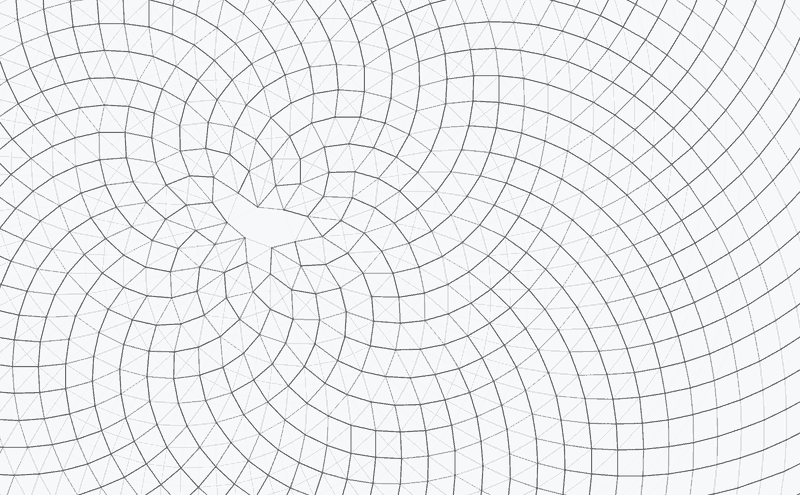

# parastichy

The image is the spiral arms of a phyllotactic field, drawn without the seeds. A seed at index n sits at angle n * alpha and radius proportional to sqrt(n). Connecting seed n to seed n + k, over and over, traces k spiral arms through the field. For most k those arms are stretched and invisible; for a few they run through the nearest neighbours and the eye picks them out.



## Measured, not assumed

Which k survive is not assumed. For a grid of radii the program measures the real distance between seed n and seed n + k, and every family is drawn with an opacity falling off from how close it came to being the shortest. Small families hold the centre, large ones the rim, and the bands shift outward as the field grows, which is how a sunflower head is organised.

At the golden angle the surviving families are 2, 3, 5, 8, 13, 21, 34, 55 and 89. No Fibonacci number appears anywhere in the program, so the sequence is a result of the measurement rather than something built into the drawing.

## The sweep

Alpha sweeps slowly through a band two and a half degrees either side of the golden angle, lingering at the golden angle and crossing the extremes quickly. Away from it the weave holds near the centre and comes apart at the rim. The clip above is one half of the 32 second cycle, from the golden angle out to an extreme and back.

The centre of the field follows the mouse. Click to hold a frame.

## Checking the measurement

The sketch measures distances at one seed in each of 48 bands, looks only forward and only up to an offset of 140, keeps four offsets per band and interpolates between bands. `NeighbourValidation` checks that shortcut against an exact search. It places the seeds again from the definition, in double precision, and finds the true three nearest neighbours of every seed at any offset in either direction, stopping only when the radial gap alone rules out anything closer. A seed's links to its first and second nearest neighbours are the spirals the eye sees, so those are the links that have to be drawn.

Over 33 angles across the sweep, in the field visible from the starting centre, the sketch draws every first and second nearest-neighbour link it could have found. The mean gap between its opacity and the opacity the same formula gives from exact distances is 0.023, about 94% of the drawn ink lies on true nearest-neighbour links, and 48 bands is close to where more bands stop helping: 24 bands give 0.030, 96 give 0.021. The links it does miss, about 0.5% of them, all have an offset beyond 140, such as the 144 arms that appear at the rim just below the golden angle. When the mouse pulls the centre into a corner the far rim comes into view, offsets above 140 take over there and only 87% of nearest links are drawn.

The check fails if the bands lose a contact link within their offset range or if the opacity error rises above 0.03.

## Running

The sketch needs `core.jar` from Processing.

```
javac -cp <core.jar> -d out src/*.java
java  -cp <core.jar>:out Parastichy
java  -cp <core.jar>:out NeighbourValidation
```

On Windows use `;` instead of `:` in the classpath.
